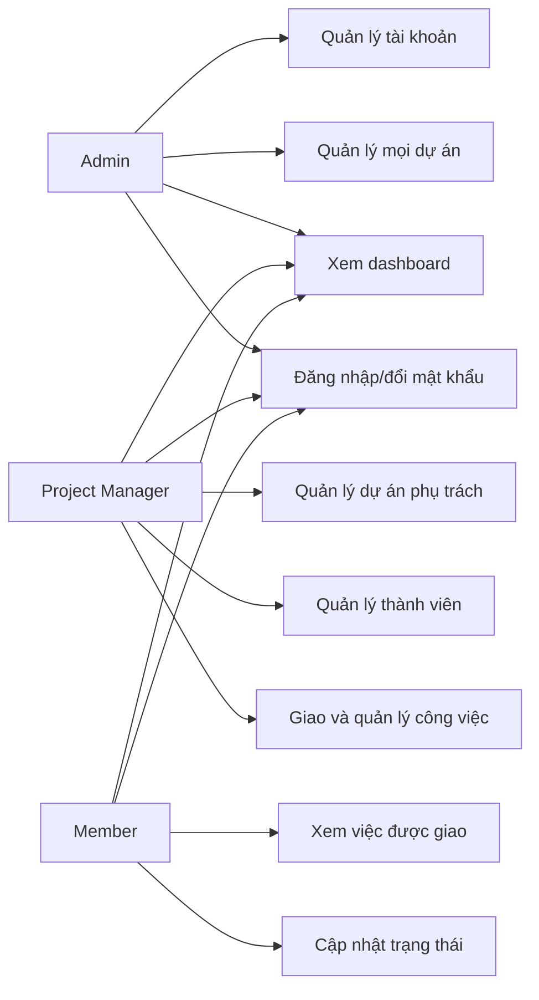

# Use case

## 1. Sơ đồ tổng quát

## 2. Danh sách use case

| Mã | Use case | Tác nhân | Kết quả |
|---|---|---|---|
| UC-01 | Đăng nhập | Tất cả | Nhận JWT và vào hệ thống |
| UC-02 | Quản lý tài khoản | Admin | Tài khoản được tạo/sửa/khóa |
| UC-03 | Tạo dự án | Admin, PM | Dự án mới được lưu |
| UC-04 | Quản lý thành viên dự án | Admin, PM sở hữu | Danh sách thành viên được cập nhật |
| UC-05 | Tạo và giao công việc | Admin, PM sở hữu | Task được giao đúng thành viên |
| UC-06 | Cập nhật trạng thái | Admin, PM, assignee | Trạng thái và thời gian hoàn thành được cập nhật |
| UC-07 | Tìm kiếm/lọc công việc | Thành viên dự án | Nhận đúng tập công việc cần xem |
| UC-08 | Xem Kanban | Thành viên dự án | Task được nhóm theo 4 trạng thái |
| UC-09 | Xem dashboard | Người dùng hợp lệ | KPI đúng với phạm vi dữ liệu được phép xem |

## 3. Đặc tả use case chính

### UC-01 — Đăng nhập

- Tiền điều kiện: tài khoản tồn tại và đang hoạt động.
- Luồng chính: nhập email/mật khẩu → hệ thống xác thực → trả token và hồ sơ → chuyển tới dashboard.
- Ngoại lệ: sai thông tin trả 401; tài khoản bị khóa trả 403.

### UC-03 — Tạo dự án

- Tác nhân: Admin hoặc PM.
- Dữ liệu: tên, mô tả, ngày bắt đầu, hạn kết thúc.
- Hậu điều kiện: người tạo là owner và là thành viên dự án.
- Validation: tên bắt buộc; hạn kết thúc không trước ngày bắt đầu.

### UC-05 — Tạo và giao công việc

- Tiền điều kiện: dự án tồn tại; actor có quyền quản lý; assignee thuộc dự án.
- Luồng chính: nhập thông tin → validate → lưu task → hiển thị trên Kanban.
- Ngoại lệ: assignee ngoài dự án trả 400; actor ngoài phạm vi trả 403.

### UC-06 — Cập nhật trạng thái

- Tiền điều kiện: actor là Admin, PM của dự án hoặc assignee.
- Luồng chính: chọn trạng thái hợp lệ → lưu thay đổi → cập nhật `completed_at` → làm mới KPI.
- Ngoại lệ: chuyển trạng thái không hợp lệ trả 400; không đủ quyền trả 403.

### UC-09 — Xem dashboard

- Admin xem số liệu toàn hệ thống; PM/Member chỉ xem dự án mình tham gia.
- Hệ thống trả tổng task, số hoàn thành, đang làm và trễ hạn.
- Kết quả phải khớp cùng bộ lọc và dữ liệu seed.
