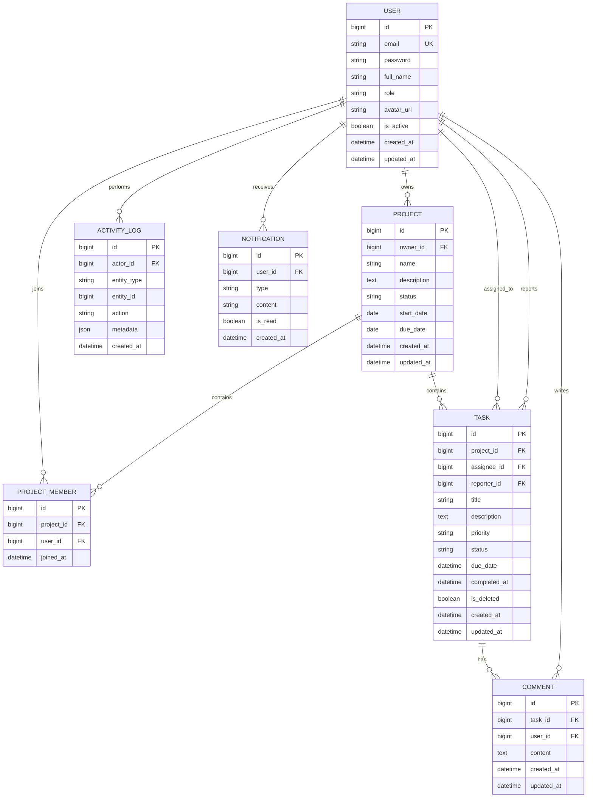

# ERD và từ điển dữ liệu

## 1. Sơ đồ ERD

## 2. Enum

- `User.role`: `ADMIN`, `PROJECT_MANAGER`, `MEMBER`.
- `Project.status`: `PLANNING`, `ACTIVE`, `COMPLETED`, `ARCHIVED`.
- `Task.priority`: `LOW`, `MEDIUM`, `HIGH`, `URGENT`.
- `Task.status`: `TODO`, `IN_PROGRESS`, `REVIEW`, `DONE`.

## 3. Ràng buộc và index

- `USER.email` duy nhất và được chuẩn hóa chữ thường.
- `PROJECT_MEMBER(project_id, user_id)` duy nhất.
- `PROJECT.owner` là người quản lý dự án; `PROJECT_MEMBER` chỉ thể hiện người tham gia để tránh hai nguồn quyền xung đột.
- `PROJECT.due_date >= start_date` khi cả hai có giá trị.
- `TASK.assignee_id` có thể rỗng, nhưng nếu có phải là thành viên dự án.
- Không xóa cứng task trong MVP; dùng `is_deleted`.
- Index: `project.owner_id`, `project_member.user_id`, `task.project_id`, `task.assignee_id`, `task.status`, `task.due_date`.
- Khi xóa dự án: ưu tiên chuyển `ARCHIVED`; không cascade xóa dữ liệu nghiệp vụ trong giao diện.
